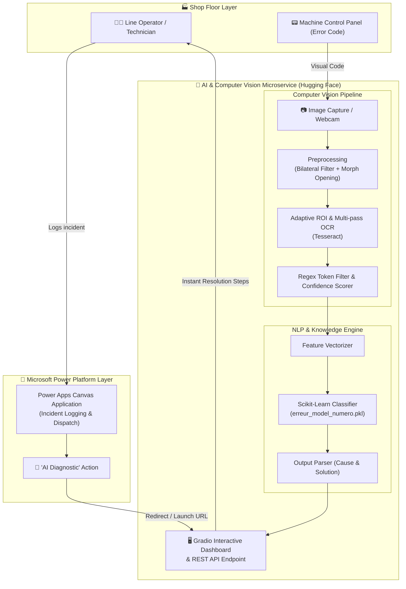

# 🏭 Lessons Learned Smart Application: End-to-End Industrial Error Diagnostic

[](https://huggingface.co/spaces/takwahafyen/Lessons_Learned_Smart_App)
[](https://www.youtube.com/watch?v=2GDLJ0Q30o0)
[](https://powerapps.microsoft.com/)
[](https://www.python.org/downloads/)
[](LICENSE)

> A production-oriented Industry 4.0 solution combining **Microsoft Power Apps** for shop-floor operators with a **Computer Vision & NLP microservice** hosted on Hugging Face Spaces. It automatically reads error codes from industrial machine screens and delivers immediate diagnostic root causes and standard recovery procedures (*Lessons Learned*).

---

## 🔗 Quick Links & Live Demonstrations

* 🎥 **YouTube Video Walkthrough:** [Watch the Full Demonstration](https://www.youtube.com/watch?v=2GDLJ0Q30o0)
* 🤗 **Live Interactive ML App:** [Hugging Face Space (Lessons_Learned_Smart_App)](https://huggingface.co/spaces/takwahafyen/Lessons_Learned_Smart_App)
* 💻 **GitHub Source Code:** [takwahafyen/Lessons-Learned-Smart-Application](https://github.com/takwahafyen/Lessons-Learned-Smart-Application)

---

## 🎯 Executive Summary & Industrial Context

In high-volume manufacturing environments, unplanned machine downtime directly affects production throughput and creates significant operational costs. Maintenance technicians and line operators frequently struggle to quickly identify the root causes of cryptic error codes displayed on machine control panels.

### The Problem:
* Manual lookup of error codes in thick binders or disparate Excel files is slow and prone to human error.
* Plant lighting, reflections, screen scratches, and low contrast make off-the-shelf OCR fail.
* Valuable historical resolution knowledge (*Lessons Learned*) remains siloed instead of being available at the machine operator's fingertips.

### The Solution:
This project delivers a **cohesive end-to-end ecosystem**:
1. **Frontend (Power Apps):** A mobile/tablet canvas application built for workshop technicians to manage incident reports and initiate diagnostics.
2. **AI Microservice (OpenCV + Tesseract + Scikit-Learn):** A computer vision and NLP model deployed on Hugging Face Spaces that extracts noisy error codes and predicts the standardized root cause and repair procedure in milliseconds.

---

## 🏛️ System Architecture



---

## 📂 Repository Structure

The repository is structured as a **clean enterprise monorepo**, strictly decoupling the front-end business application from the machine learning inference engine:

```text
Lessons-Learned-Smart-Application/
├── power-apps/                    # 📱 Microsoft Power Platform Layer
│   ├── README.md                  # Screen breakdown & setup instructions
│   ├── assets/                    # Screenshots of the Power App interface
│   └── solution/                  # Exported .msapp package / Solution .zip
│
├── ml-service/                    # 🧠 Computer Vision & ML Microservice (Hugging Face)
│   ├── src/
│   │   ├── config.py              # Centralized hyperparameters & paths
│   │   ├── ocr_engine.py          # OpenCV preprocessing & Tesseract strategies
│   │   └── model_predictor.py     # NLP classification & output parsing
│   ├── app.py                     # Gradio interface & REST API definition
│   ├── requirements.txt           # Python dependencies
│   ├── packages.txt               # Debian/Ubuntu dependencies (Tesseract)
│   └── .gitattributes             # Git LFS configuration for models
│
├── .gitignore
├── LICENSE
└── README.md                      # Comprehensive project documentation
```

---

## 🔬 Technical Highlights of the AI Engine

### 1. Multi-Strategy Computer Vision Engine (`src/ocr_engine.py`)
Machine screens in factory environments suffer from glare and varying focal distances. The OCR engine combines three concurrent evaluations:
* **Central ROI Bounding Box:** Focuses computation on the center 50% of the frame where operators typically center the screen.
* **Morphological & Bilateral Preprocessing:** Removes high-frequency camera noise while preserving sharp font edges.
* **Fallback Cascade:** Evaluates Adaptive Gaussian Thresholding and Otsu Binarization in parallel, selecting the token that satisfies the industrial regex with the highest confidence score (`conf > 25.0`).

### 2. Exact Machine Learning Model Architecture & Specifications (`src/model_predictor.py`)

Directly extracted from the trained model file (`erreur_model_numero.pkl`):

* **Vectorization Technique:** **`TfidfVectorizer`** (`sklearn.feature_extraction.text`)
  * Transforms the normalized alphanumeric error codes (e.g., `"E1024"`) into Term Frequency-Inverse Document Frequency (TF-IDF) feature vectors.
* **Core Classification Algorithm:** **`RandomForestClassifier`** (`sklearn.ensemble`)
  * An ensemble of Decision Trees that captures non-linear relationships between error code patterns and historical failure modes.
* **Multi-Target Architecture:** **`MultiOutputClassifier`** (`sklearn.multioutput`)
  * Extends the Random Forest to predict **two distinct target outputs simultaneously**:
    1. **Target 1 (`Cause Racine`)**: The root failure cause.
    2. **Target 2 (`Solution Standard`)**: The validated corrective action.
* **Learning Paradigm:** **Supervised Multi-Output NLP Classification**.
* **Inference Latency:** Sub-15 ms per prediction, ensuring instantaneous feedback on the shop-floor.

---

## ⚡ Quickstart Guide

### Running the ML Microservice Locally

#### Prerequisites
* Python 3.9 - 3.11
* [Tesseract OCR](https://github.com/tesseract-ocr/tesseract) installed on your system.

```bash
# 1. Clone the repository
git clone https://github.com/takwahafyen/Lessons-Learned-Smart-Application.git
cd Lessons-Learned-Smart-Application/ml-service

# 2. Create and activate virtual environment
python -m venv .venv
# Windows:
.venv\Scripts\activate
# Linux/macOS:
source .venv/bin/activate

# 3. Install dependencies
pip install --upgrade pip
pip install -r requirements.txt

# 4. Place your trained model file
# Ensure 'erreur_model_numero.pkl' is inside ml-service/

# 5. Launch the application
python app.py
```
Access the application in your browser at `http://localhost:7860`.

---

## 🔄 Two Modes of Power Apps Integration

| Feature | Pattern 1: Redirection (Current) | Pattern 2: Headless API (Advanced) |
| :--- | :--- | :--- |
| **How it works** | Power Apps button calls `Launch(HF_URL)` | Power Automate flow calls `/api/diagnose` |
| **User Experience** | Opens Gradio in a mobile webview/browser | Operator stays entirely inside Power Apps |
| **Data Flow** | Manual inspection | Automated JSON response populating form |
| **Implementation Effort** | Immediate (1 line of Power Fx) | Medium (Power Automate HTTP connector) |

---

## 📊 Business Impact & ROI

* **⏱️ Mean Time To Resolution (MTTR):** Decreased diagnostic lookup time from ~10 minutes to under 5 seconds.
* **🎯 Accuracy:** Filtered OCR eliminates human transcription errors when reading complex multi-digit fault codes.
* **📈 Knowledge Retainage:** Automatically connects technicians to the verified *Lessons Learned* database, preventing repetitive trial-and-error maintenance.

---

## 📜 License & Acknowledgments

This project was developed as an end-of-studies engineering graduation project (PFE).
Distributed under the **MIT License**. See `LICENSE` for details.
