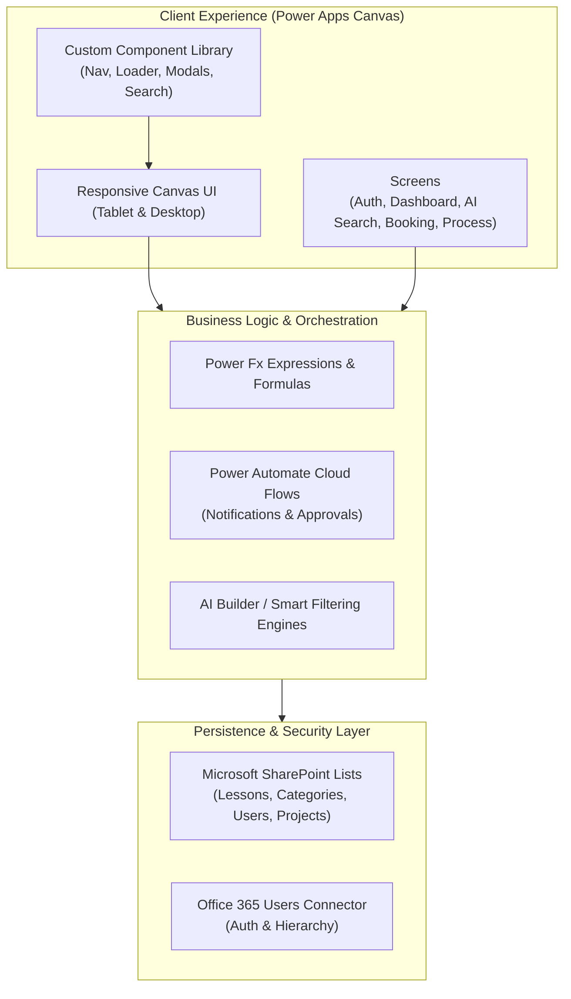

# 🎓 Lessons Learned Smart App — End of Studies Project (PFE)

<div align="center">


<p align="center">
  <b>An enterprise-grade Knowledge Management & Lessons Learned platform built on Microsoft Power Platform, incorporating AI-driven insights, multi-criteria search, role-based workflows, and executive analytics.</b>
</p>

</div>

---

## 📌 Executive Summary

During industrial engineering and multi-phase project execution, critical institutional knowledge is frequently siloed across unstructured reports, emails, and isolated team channels. This leads to repeated errors, budget overruns, and lost operational efficiency.

The **Lessons Learned Smart App** addresses this bottleneck by providing a centralized, intelligent ecosystem to capture, categorize, validate, search, and capitalize on post-project feedback and operational experiences across the enterprise.

### 🌟 Key Objectives
- **Capitalize on Organizational Experience:** Systematic capture of positive practices and corrective action plans.
- **Smart Discovery with AI:** Semantic querying, keyword filtering, and categorization of project insights.
- **Multi-Role Governance:** Dedicated workflows for contributors, reviewers, project managers, and administrators.
- **Actionable Metrics:** Executive dashboards tracking lesson adoption, recurrence reduction, and team engagement.

---

## 🏗️ Architecture & Tech Stack



### 💻 Technologies Used
| Component | Technology | Role |
| :--- | :--- | :--- |
| **Frontend UI** | **Microsoft Power Apps (Canvas)** | Unpacked via Power Platform CLI / MSApp YAML format |
| **Logic Engine** | **Power Fx Formulas** | Declarative state management, filtering, and role validations |
| **Cloud Automation** | **Power Automate** | Automated approval processes and email alerts |
| **Data Store** | **Microsoft SharePoint Online** | Relational list structure for lessons, logs, and configurations |
| **Identity & Security** | **Office 365 Users Connector** | Single Sign-On (SSO) and departmental role-based access control |
| **AI Capabilities** | **AI Builder / Cognitive Search** | Intelligent extraction and pattern identification across feedback |

---

## 🚀 Key Modules & Features

### 1. 🔐 Authentication & Onboarding
- **Single Sign-On (SSO):** Seamless integration with corporate Office 365 directory.
- **Role Validation:** Dynamic UI masking and screen restrictions based on user privileges (`Cmp_Restrict_Users`, `Cmp_Validation`).
- **User Self-Service:** Registration, password recovery flows, and user profile management.

### 2. 📝 Lesson Ingestion & Capitalization (`Create.pa.yaml`)
- Multi-step structured intake form capturing:
  - Context & Project metadata (phase, department, business unit).
  - Problem Statement, Root Cause, and Immediate Impact.
  - Recommended Actions & Best Practices.
  - Multi-attachment support (evidence files, diagrams, specifications).

### 3. 🧠 Smart Search & Discovery (`AI.pa.yaml`)
- Search by keywords, project domain, severity, and tags.
- Dynamic filtering engine providing instant recommendations.
- Interactive detail view (`info11.pa.yaml`, `info2.pa.yaml`, `info33.pa.yaml`).

### 4. 📊 Executive Dashboard (`Dashboard.pa.yaml`)
- KPIs on total lessons documented, approval statuses, and category trends.
- Quick filters for high-impact lessons learned.
- Export and sharing capabilities for project debriefs.

### 5. 🔄 Workflow & Governance (`Process.pa.yaml`)
- Stage-gate approval cycle ensuring all published lessons meet corporate quality standards.
- Real-time status notifications for submitters and reviewers.

---

## 📂 Project Structure

```text
├── Assets/                 # Media assets, icons, brand vectors (SVG, PNG, MP4)
├── Components/             # Reusable UI component schemas (JSON)
├── Controls/               # Canvas control definitions and properties
├── References/
│   ├── DataSources.json    # SharePoint & O365 connection references
│   ├── Themes.json         # Corporate color palettes & styles
│   └── ModernThemes.json   # Modern Fluent UI theming definitions
├── Resources/
│   └── PublishInfo.json    # App manifest, environment settings, and build info
└── Src/                    # Human-readable Power Fx source files (MSApp YAML)
    ├── AI.pa.yaml          # AI & smart search interface
    ├── App.pa.yaml         # Application startup logic (OnStart)
    ├── Dashboard.pa.yaml   # Analytics and reporting interface
    ├── Create.pa.yaml      # Lesson intake forms
    ├── Components/         # Modular header, sidebar navigation, loader, etc.
    └── ...
```

---

## 🛠️ How to Deploy & Run

### Prerequisites
- Active Microsoft 365 / Power Apps license (Developer or Corporate plan).
- Microsoft Power Platform CLI (`pac`) or Power Platform VS Code Extension.
- Configured SharePoint Online site for data storage.

### Packaging & Importing
1. **Clone this repository:**
   ```bash
   git clone https://github.com/<your-username>/lessons-learned-smart-app.git
   cd lessons-learned-smart-app
   ```

2. **Pack the source into an `.msapp` package:**
   ```bash
   pac canvas pack --sources . --msapp "LessonsLearnedApp.msapp"
   ```

3. **Open in Power Apps Studio:**
   - Navigate to [make.powerapps.com](https://make.powerapps.com).
   - Click **Apps** > **Import canvas app** (or open Power Apps Studio and select **Open** > **Browse files**).
   - Select `LessonsLearnedApp.msapp`.
   - Rebind the SharePoint list data sources to your organization's environment.
   - Click **Save** and **Publish**.

---

## 👤 Author & Academic Context

- **Author:** Takwa (PFE Candidate)
- **Degree:** End of Studies Project (Projet de Fin d'Études - PFE)
- **Field:** Software Engineering / Information Systems / Low-Code & Cloud Engineering
- **Supervision & Context:** Corporate stage / academic partnership

---

## 📄 License
This project is licensed under the [MIT License](LICENSE) — free for educational, demonstration, and enterprise reference use.
