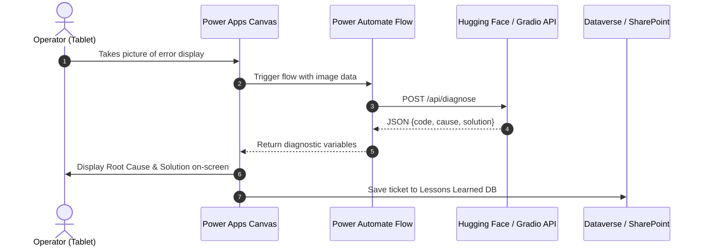

# 📱 Power Apps Component: Lessons Learned Smart Assistant

This directory contains the **Microsoft Power Apps (Canvas App)** implementation designed for workshop operators and maintenance technicians.

---

## 🎯 Role in the Architecture

The Power App acts as the **primary enterprise front-end**:
* **User Authentication & Role Management:** Integrates seamlessly with Microsoft 365 / Azure Active Directory.
* **Shop-floor Ergonomics:** Optimized for mobile phones and rugged industrial tablets used in manufacturing plants.
* **Maintenance Workflow Management:** Allows operators to log incidents, check past historical maintenance tickets, and initiate smart AI diagnosis.

---

## 🔄 Integration with the Machine Learning Engine

There are **two architectural patterns** to connect this Power App to the Hugging Face ML Space:

### Pattern A: Direct Operator Redirection (Current Implementation)
When the operator encounters a machine breakdown:
1. The operator clicks the **"Scan / AI Diagnostic"** button inside the Power App.
2. The Power Fx formula launches the Hugging Face Space web interface:
   ```powerfx
   Launch("https://huggingface.co/spaces/takwahafyen/Lessons_Learned_Smart_App")
   ```
3. The operator captures the error code with their device camera, reviews the diagnosis, and copies the solution back to the maintenance log.

🎥 **Watch this flow in action:** [YouTube Video Demonstration](https://www.youtube.com/watch?v=2GDLJ0Q30o0)

---

### Pattern B: Seamless In-App REST API (Production Enterprise Grade)
Instead of opening a separate browser window, the Power App communicates directly with the ML backend:
1. Operator takes a photo using the **Camera control** inside Power Apps.
2. A **Power Automate Cloud Flow** (or Custom Connector) triggers on button click.
3. The Flow sends the base64/binary image via HTTP POST to the ML endpoint (`/api/diagnose`).
4. The JSON response containing `{"detected_code": "E104", "cause": "...", "solution": "..."}` is returned and populates the Power Apps fields automatically!



---

## 📂 Directory Contents

* `solution/`: Contains the exported Power Apps solution archive (`.zip`) or canvas app package (`.msapp`).
* `assets/`: UI screenshots, wireframes, and workflow diagrams.

---

## 📥 How to Import into Power Apps Studio

1. Sign in to [Power Apps Maker Portal](https://make.powerapps.com/).
2. Select your target environment (Dev/UAT).
3. Go to **Apps** $\rightarrow$ **Import canvas app** (or **Solutions** $\rightarrow$ **Import solution**).
4. Select the `.msapp` or `.zip` file from the `solution/` folder.
5. Review connections (Camera, Office 365 Users, SharePoint/Dataverse) and click **Publish**.
